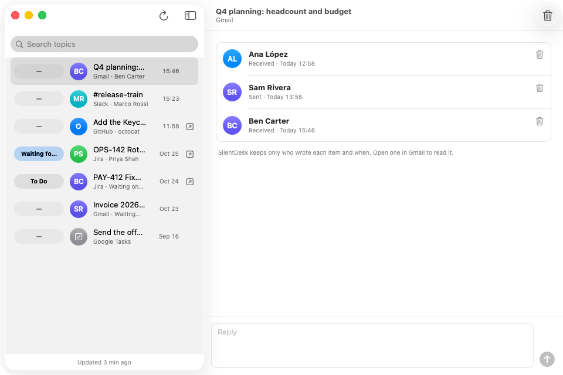

# SilentDesk

A quiet desktop task tracker for work. It pulls your email, chat messages, issues, pull requests and tasks into one queue of topics.

## Why I created it

We live in an era of massive information flows, and those flows went off the charts in 2026 with the arrival of more powerful AI.


By the numbers:
- Across 718 companies using AI coding agents, code review time rose 49% while finished work didn't increase ([Harvard study](https://www.techradar.com/pro/ai-agents-are-great-at-writing-new-code-but-then-the-human-bottleneck-slows-everything-down)).
- Workers who closely oversee AI tools are 19% more likely to report information overload ([Harvard Business Review](https://hbr.org/2026/03/when-using-ai-leads-to-brain-fry)).
- Managers now average 12.1 direct reports, up from 10.9 a year earlier ([Gallup](https://www.gallup.com/workplace/700718/span-control-optimal-team-size-managers.aspx)).


But more importantly, take five minutes to think about how many more messages and quick decisions land on you each day compared to last year. You probably won't need any other number.

## How it works

SilentDesk puts everything you need to know about or act on into one clean, minimal UI, sorted and prioritized ahead of time by your rules.


It was built for you, and its top mission is to protect your focus time by letting you control the rate and direction of context switching.

<p align="center">
  
</p>

## How it's built

- **Security comes right after focus.** All local data is encrypted at rest with SQLCipher, and the key stays in your OS keychain.
- **Open source under Apache 2.0.** You can always fork it and build it yourself. The Mac App Store version may need a small fee, but this repo is free to clone and change however you like.
- **Your data stays with you.** SilentDesk talks directly to Gmail, Slack, GitHub, Jira and Google Tasks from your computer. No middleman server, no telemetry.
- **Built for work.** Your data and credentials never go anywhere but your company's own services. The code is fully auditable, and every release ships as a signed binary.

## Status

SilentDesk is under development. The current focus is GitHub: its pull requests and their status. Work on the other connectors comes later.

## Run the apps

On a Mac:

```sh
git clone https://github.com/the-guish/silentdesk.git
cd silentdesk/apple/app
swift run SilentDeskMac --demo     # quick look over made-up data
Scripts/bundle.sh                  # builds .build/SilentDesk.app
open .build/SilentDesk.app         # the real app
```

On Linux, the app needs [uv](https://docs.astral.sh/uv/) and libadwaita 1.5 or newer (Ubuntu 24.04, Debian 13). It has no demo mode.

```sh
sudo apt-get install gir1.2-adw-1 gir1.2-gtk-4.0 python3-gi   # GTK, libadwaita and PyGObject
git clone https://github.com/the-guish/silentdesk.git
cd silentdesk/linux/gtk
./run.sh                           # the real app
```

## License

Apache License 2.0. See [LICENSE](LICENSE), [NOTICE](NOTICE) and [AUTHORS](AUTHORS).
