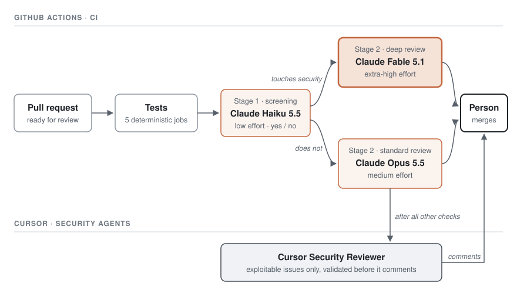

# Required AI Security Review

Every ready pull request gets two AI security reviews before a person merges it. Claude Code reviews it in two stages inside CI. Cursor's Security Reviewer reviews it last, on Cursor's side. The two come from different vendors and different models. Each can catch issues the other misses.

## How a pull request is reviewed

1. A pull request becomes ready for review. Drafts get the tests only.
2. The `Tests` check passes when all five test jobs pass. The AI review waits for it, so it spends nothing on broken code.
3. Claude screens the diff and answers one question: does it touch security?
4. Claude reviews the diff. The screening's answer sets the model and the effort.
5. Cursor's Security Reviewer reviews the same pull request after all other checks finish.
6. A person reads both reviews and decides on the merge.

## Claude Code Security Review

The review runs in GitHub Actions, in two stages.

| Stage | Model | Effort | Job |
|---|---|---|---|
| 1. Screening | Claude Haiku 5.5 | Low | Decides whether the diff touches security. Answers yes when unsure. |
| 2. Deep review | Claude Fable 5.1 | Extra high | Reviews a diff that touches security. |
| 2. Standard review | Claude Opus 5.5 | Medium | Reviews any other diff. |

The screening is fast and cheap. A wrong "no" still gets a full review by Opus. A wrong "yes" costs only usage.

The review reads the diff and the code around it. It reports only issues with a concrete way to exploit them, at high or medium confidence. It posts each finding as an inline comment, with the issue, the exploit and the fix. Its summary comment shows the result, the depth, the model, the effort, the commit and the areas it checked.

### Why Fable for the deep review

Anthropic calls Fable 5.1 one of "the world's most advanced models for coding and knowledge work". Version 5.1 opened it to security work: "Fable 5.1 can now be used to discover software vulnerabilities—though not to develop exploits for them."

That fits a review. The reviewer finds the flaw and explains it.

Fable also holds up on long, careful work:

- "Fable 5.1 avoids shortcuts that result in poorer-quality work."
- It is "smart enough to fix the root causes of software issues".
- Red Hat: "it correctly identified the root cause of every broken build we tested, across all the effort levels."

At extra-high effort, Fable spends more time tracing each change through the code before it answers.

## Cursor Security Reviewer

Cursor's Security Reviewer is one of Cursor's Security Agents. It is a separate product from Bugbot, Cursor's general code reviewer. Cursor describes its job as: "Review pull requests for exploitable security issues and flag only validated findings before merge."

It works much like the Claude review, with its own model and prompts:

- It "reasons about the diff and surrounding code".
- It tries to "trace attacker-controlled input to the real sink" and to "verify whether existing controls already block exploitation".
- It reports "only medium, high, or critical findings with a plausible attack path and concrete code evidence".
- It posts "inline PR comments on the exact diff lines for each current finding".

It reports as the check `Cursor Security Agent: Security Reviewer`. With no validated finding, it posts no comment.

Cursor runs an agentic security review on its own code. In March 2026, Cursor wrote that it "has run on thousands of PRs and prevented hundreds of issues from reaching production". Cursor first sent the findings to its security team, then turned on comments, then made the review a blocking check.

## What two vendors mean for safety

**Two reviews miss less than one.** Each model has blind spots from its training and its prompt. A second model from another vendor has different blind spots. An issue gets through only when both miss it.

This repository has seen it happen. Cursor Bugbot, Cursor's general code reviewer, also reviews each pull request. On pull request #37, Claude and Bugbot both found that a changed prompt could steer the Claude app. Only Bugbot found that older branches would break. Cursor's Security Reviewer reported nothing.

**Two reviews still prove nothing.** A clean result from both lowers the risk. It does not mean the code is safe. A person still reads the change.

**Two reviews have costs:**

- **More comments.** The two reviews overlap. Expect some findings twice.
- **More places that see the code.** The diff goes to Anthropic and to Cursor. Keep secrets out of the repository, as always.
- **Two targets for prompt injection.** Both reviewers read text written by the pull request's author. The Claude review runs only on pull requests from this repository, and it can only read code and post comments.

## What "required" means

The Claude review's check is always named `Claude security review`. Cursor's is `Cursor Security Agent: Security Reviewer`. The repository's rules for `main` can mark both as required. A required check blocks the merge until the review has run.

The Claude check passes when the review finishes, with or without findings. The findings are comments for a person to resolve. To block merges on open findings, the rules for `main` can also require conversation resolution.

Changing these rules is a repository setting. The repository owner makes it.

## Limits

- Drafts and pull requests from forks get no Claude review. Forks get no secrets.
- The Claude review posts as the Claude GitHub app. The app acts only from workflows identical to the ones on `main`. A pull request that changes a workflow, a prompt or a Claude instruction file such as `CLAUDE.md` posts as `github-actions[bot]` instead.
- The AI reviews add to the tests and to a person's review. They replace neither.

## Files

- `.github/workflows/ci.yml`: the `Tests`, `Claude security screening` and `Claude security review` jobs.
- `.github/prompts/security-screening.md`: the screening's question.
- `.github/prompts/security-review.md`: the review's instructions and its comment template.

## Sources

- Anthropic, [Introducing Claude Fable 5.1 and Claude Mythos 5.1](https://www.anthropic.com/claude-fable-and-mythos-5-1).
- Cursor, [Security Agents](https://cursor.com/docs/security-agents).
- Cursor, [Find vulnerabilities](https://cursor.com/workflows/autonomous-agents/find-vulnerabilities).
- Cursor, [Securing our codebase with autonomous agents](https://cursor.com/blog/security-agents), 2026-03-16.
